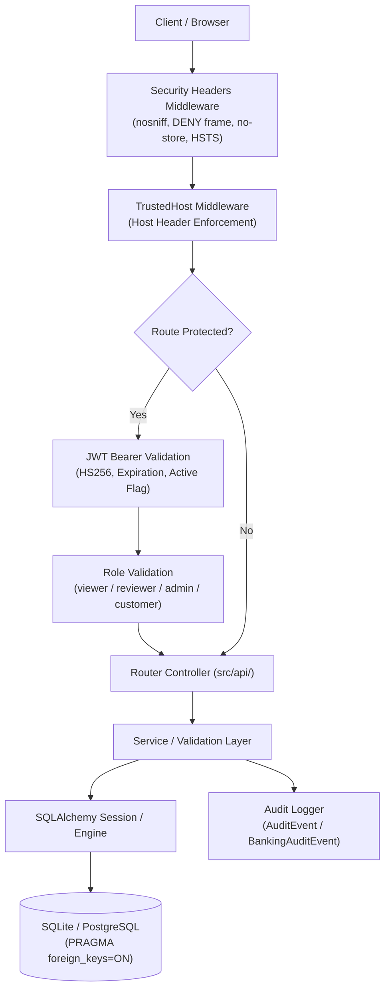

# PROJECT_CONTEXT.md — NileOps Technical Reference

> **Ground Truth Document for NileOps Agents & Engineers**  
> *Last Updated:* 2026-11-07  
> *Project Name:* NileOps — Digital Banking Operations Employee (مساعد العمليات المصرفية الرقمية)  
> *Repository Root:* `C:\AI\NileOps`  
> *Status:* Portfolio-grade banking operations backend & operator console (Active Development)

---

## 1. Executive Summary

**NileOps** is an enterprise-grade digital banking operations backend designed to automate, streamline, and govern banking workflows—specifically Know Your Customer (KYC) onboarding, document validation, customer complaints, core banking inquiries, and banking policy guidance.

### Core Philosophy
1. **Deterministic Rule Supremacy:** Critical banking transitions (approvals, rejections, KYC pass/fail) are strictly governed by deterministic business logic, not non-deterministic AI.
2. **Human-in-the-Loop:** AI and OCR components act purely as advisory tools (extracting text, drafting explanations, finding policy clauses). All consequential banking actions require authenticated human review with validated state transitions.
3. **Defense in Depth & Auditing:** Comprehensive audit trails (`AuditEvent`, `BankingAuditEvent`), Argon2id password hashing, constant-time authentication responses, brute-force rate limiting, and automated PII redaction.
4. **Arabic-First Design:** Fully localized for Egyptian banking contexts, supporting Arabic OCR, Arabic-Indic numerals, Egyptian dialect policy queries (BM25 RAG), and RTL operational dashboards.

---

## 2. Technology Stack & Manifest Analysis

| Layer | Technologies & Libraries | Key Details |
|---|---|---|
| **Language & Runtime** | Python 3.13 | Strict typing, async/await, modern dataclasses |
| **Web Framework** | FastAPI, Starlette, Uvicorn | High-performance ASGI REST API |
| **Data Validation & Settings** | Pydantic v2, `pydantic-settings` | Schema enforcement, settings validation, custom validators |
| **ORM & Database** | SQLAlchemy 2.0, SQLite (Dev/Test), PostgreSQL (Target) | `PRAGMA foreign_keys=ON` enforced on SQLite, connection pooling |
| **Security & Cryptography** | `pwdlib[argon2]`, `PyJWT` | Argon2id password hashing, HS256 JWT tokens, anti-timing dummy hashes |
| **OCR Engine** | Tesseract OCR (`ara` + `eng`), Pillow, Poppler (`pdftoppm`) | Protocol-driven abstraction, RTL coordinate sorting |
| **Information Retrieval (RAG)** | Custom Deterministic BM25 (Arabic), stopword lists, dialect rewrites | Explainable retrieval, hallucination guardrails, optional local Ollama (`qwen2.5:7b-instruct`) |
| **Frontend Dashboard** | Vanilla ES6+ JavaScript, CSS3, HTML5 | Zero-build pipeline, native Arabic RTL support, Cairo font |
| **Testing & Quality** | Pytest (502 tests), `fastapi.testclient.TestClient`, HTTPX | Unit, integration, security hardening, and hallucination regression tests |
| **Containerization & Ops** | Docker (`python:3.13-slim`), Docker Compose | Unprivileged container execution (`UID 10001`), persistent volumes |

---

## 3. Directory Layout & Architecture

NileOps follows a **Modular Layered Architecture** with clean domain separation:

```text
c:\AI\NileOps/
├── deploy/                     # Production deployment assets
│   ├── entrypoint.sh           # Container entrypoint (runs init_db & load_policies)
│   └── env.production.example  # Production environment template
├── data/                       # Local SQLite database files (gitignored)
├── docs/                       # Comprehensive technical and API documentation
│   ├── api_documentaion.md     # Endpoint descriptions and schemas
│   ├── complaints_api.md       # Complaint routing specifications
│   ├── data_model.md           # ER diagrams and table structures
│   ├── deployment.md           # Production hardening and TLS guides
│   ├── documents_ocr.md        # OCR architecture & confidence thresholds
│   ├── explanations.md         # Guardrails for AI explanations
│   ├── policies_rag.md         # BM25 RAG architecture & dialect rewrites
│   └── security.md             # Threat model, PII, and RBAC matrix
├── knowledge/                  # Ground-truth banking policies (Markdown)
│   ├── eval_questions.json     # RAG evaluation benchmark queries
│   ├── eval_questions_dialect.json # Egyptian colloquial dialect test set
│   └── policies/               # Formal policies (POL-ACC, POL-KYC, POL-CARD, etc.)
├── scripts/                    # CLI tooling, seeding, and database initialization
│   ├── setup_demo.py           # Single-command dev bootstrap (seed users, data, policies)
│   ├── init_db.py              # DDL schema creation
│   ├── load_policies.py        # Tokenizes and indexes policies into database
│   ├── seed_kyc_data.py        # Generates synthetic KYC records
│   ├── seed_core_banking.py    # Seeds accounts, transactions, and branches
│   └── create_user.py          # Interactive/CLI user provisioning
├── src/                        # Core Application Source Code
│   ├── ai/                     # AI interface definitions
│   ├── api/                    # FastAPI Routers & HTTP Controllers
│   │   ├── main.py             # FastAPI factory, security middlewares, router mounts
│   │   ├── auth.py             # Login, token issuance, throttling, audit logging
│   │   ├── admin.py            # User management, audit inspection, system status
│   │   ├── banking.py          # Bank accounts, transfers, card issuance
│   │   ├── complaints.py       # Complaint ingestion, classification & SLA
│   │   ├── customers.py        # Customer profiles, balances, relationship view
│   │   ├── dashboard.py        # Aggregated operations metrics (PII-free) & static assets
│   │   ├── documents.py        # Document upload, storage, and OCR execution
│   │   ├── explanations.py     # AI explainability endpoints with guardrails
│   │   ├── policies.py         # Policy search (BM25 + optional LLM)
│   │   └── portal.py           # Self-service customer registration & requests
│   ├── core/                   # Cross-cutting foundational modules
│   │   ├── config.py           # Pydantic Settings, environment validation
│   │   ├── auth.py             # Dependency injection: get_current_user, require_roles
│   │   ├── passwords.py        # Password complexity rules & validator
│   │   ├── pii.py              # Automated regex masking of IDs, phones, cards
│   │   ├── security.py         # JWT tokens & Argon2 password operations
│   │   └── throttle.py         # In-memory IP + username rate-limiting
│   ├── db/                     # Database engine and session lifecycle
│   │   └── session.py          # SQLAlchemy SessionLocal, SQLite PRAGMA listener
│   ├── explain/                # Guarded AI explanation service
│   │   ├── facts.py            # Structured fact extraction from entities
│   │   ├── guard.py            # Anti-hallucination & anti-bias output validation
│   │   └── service.py          # Template-first / local-LLM explanation builder
│   ├── models/                 # SQLAlchemy 2.0 ORM Entities
│   │   ├── banking.py          # Customer, BankAccount, AccountTransaction, Complaint
│   │   ├── documents.py        # DocumentFile, ExtractedField
│   │   ├── kyc.py              # KYCApplication, KYCDocument, ValidationResult, AuditEvent
│   │   ├── policies.py         # PolicyDocument, PolicyChunk
│   │   ├── portal.py           # CustomerAccount, CustomerKycLink
│   │   └── user.py             # User (auth & RBAC)
│   ├── ocr/                    # Document OCR & Field Extraction
│   │   ├── engine.py           # Tesseract abstraction (supports images & PDFs)
│   │   └── fields.py           # Heuristic/Regex extractor for National IDs & utility bills
│   ├── rag/                    # Deterministic Retrieval-Augmented Generation
│   │   ├── chunking.py         # Markdown structural chunker (headings, tables)
│   │   ├── retrieval.py        # Custom BM25 retrieval, Arabic stemmer/normalizer
│   │   ├── answer.py           # Extractive citation assembler & abstention logic
│   │   ├── llm.py              # Local Ollama client (strictly isolated from cloud)
│   │   └── store.py            # SQLite storage for indexed chunks
│   ├── services/               # Deterministic Business Logic Services
│   │   ├── kyc_validator.py    # Strict validation of required KYC documents
│   │   ├── complaint_router.py # Keyword-based classifier, department router & SLA assigner
│   │   ├── document_checks.py  # File format, size, mime-type, quality checks
│   │   └── file_storage.py     # Content-addressable SHA256 file persistence
│   └── web/                    # Static Web UI Dashboard (Arabic RTL)
│       ├── dashboard.html      # Main operational single-page app container
│       ├── style.css           # Clean modern CSS layout
│       ├── app.js              # State management & routing router
│       └── v_*.js              # Modular UI views (KYC, Overview, Admin, Explain, etc.)
├── storage/                    # Uploaded document binary storage (gitignored)
├── tests/                      # Comprehensive Test Suite (502 tests)
├── docker-compose.yml          # Container stack definition
├── Dockerfile                  # Container build instructions
└── requirements.txt            # Python dependencies
```

---

## 4. Architectural Flows & Lifecycles

### A. HTTP Request & Security Middleware Flow


### B. KYC Verification & Review Lifecycle
1. **Application Submission:** Created with state `PENDING` along with document requirements (`National ID`, `Proof of Address`, `Customer Data Form`).
2. **Document Upload & OCR:** Documents stored under hashed path; Tesseract extracts text and field heuristics locate national ID numbers, names, and dates.
3. **Deterministic Validation (`kyc_validator.py`):**
   - Verifies whether all 3 required documents exist.
   - Evaluates OCR document validity, expiration dates, and consistency.
   - Persists findings to `ValidationResult`.
4. **Human Review Decision:**
   - Allowed transitions: `PENDING` -> `IN_REVIEW` -> `APPROVED` / `REJECTED` / `NEEDS_INFORMATION`.
   - Hard Rule: Application **cannot** transition to `APPROVED` unless all required documents are explicitly marked `VALID`.
   - Reviewer identity is extracted from authenticated JWT context, never accepted from request payload.
   - Full action recorded in `AuditEvent`.

### C. Guarded RAG & Policy Explanation Flow
1. **Query Normalization:** Questions undergo Arabic normalization (alif/yaa normalization, tashkeel removal, Egyptian dialect synonym expansion).
2. **BM25 Retrieval:** Searches policy chunks; calculates `coverage` score (ratio of question terms found in document).
3. **Abstention Gate:** If coverage < `RAG_MIN_COVERAGE` (default `0.55`), the system immediately abstains with an official message without invoking any model.
4. **Guarded Generation:** If a local Ollama model is configured:
   - Output must be in Arabic (>= 70% characters).
   - Must NOT contain decision language (e.g., "نوصي بالقبول").
   - Numbers mentioned must strictly exist in retrieved context.
   - Novel token ratio must not exceed 0.40.
   - If guard fails, the system safely falls back to direct factual excerpts.

---

## 5. Security & Authentication Architecture

- **Role-Based Access Control (RBAC):**
  - `viewer`: Read-only access to KYC applications, customer profiles, and dashboard.
  - `reviewer`: Read applications + record human review decisions (approve/reject/needs_info) + validate documents.
  - `admin`: User provisioning, password resets, role changes, system status, and unified audit logs.
  - `customer`: Customer portal (view own accounts, submit account opening/card requests, file complaints).
- **Brute Force Protection (`throttle.py`):**
  - Pair Lock: 5 consecutive failed attempts on an account locks that (username, IP) pair for 15 minutes.
  - Address Lock: 20 failed attempts from an IP across all usernames triggers an IP-wide lockout.
  - Constant-time dummy verification prevents username enumeration.
- **PII Scrubbing (`pii.py`):**
  - Custom Pydantic validator `StaffNote` masks Arabic and English numeral sequences >= 8 digits with `[رقم محجوب]`.
  - Operations dashboard endpoints return only aggregates (counts, dates, codes)—never personal names or notes.

---

## 6. How to Run, Test, and Seed Locally

### Prerequisites
- Python 3.13 (or virtual environment at `.venv`)
- Optional for OCR: Tesseract-OCR binary with Arabic traineddata (`ara.traineddata`)

### Step 1: Environment Setup
```powershell
# Copy the template environment file
Copy-Item .env.example .env

# Edit .env and ensure JWT_SECRET_KEY is a random string >= 32 characters
```

### Step 2: Initialize Database and Demo Data
To initialize SQLite tables, load banking policies, generate synthetic customers, KYC applications, bank accounts, and demo users in one command:
```powershell
.\.venv\Scripts\python.exe -m scripts.setup_demo
```
*Seeded Demo Accounts (Password: `Demo-Pass-2026!`):*
- `demo_admin` (Role: `admin`)
- `demo_reviewer` (Role: `reviewer`)
- `demo_viewer` (Role: `viewer`)
- `demo_customer` (Customer portal user)

### Step 3: Run the API Server
```powershell
.\.venv\Scripts\python.exe -m uvicorn src.api.main:app --host 127.0.0.1 --port 8000 --reload
```
- Web Dashboard: [http://127.0.0.1:8000/dashboard](http://127.0.0.1:8000/dashboard)
- OpenAPI Docs (dev only): [http://127.0.0.1:8000/docs](http://127.0.0.1:8000/docs)

### Step 4: Run the Test Suite
```powershell
# Fast run (specific modules):
.\.venv\Scripts\python.exe -m pytest tests\test_kyc_validator.py tests\test_document_checks.py -q

# Run full test suite (502 tests):
.\.venv\Scripts\python.exe -m pytest -q
```

---

## 7. Observations, Pain Points & Recommendations

1. **Test Suite Duration under Argon2id:**
   - *Observation:* `pwdlib` with Argon2id parameters performs ~64MB memory cost per hash. In the full test suite (502 tests), multiple fixtures create test users, which can take ~1-2 minutes on local CPU.
   - *Recommendation:* Introduce a test configuration flag (e.g. `TESTING=true`) that configures Argon2 with reduced memory/time cost (`time_cost=1, memory_cost=1024`) strictly inside `pytest` fixtures.
2. **Missing Linter / Code Formatter Configuration:**
   - *Observation:* No `pyproject.toml` or `ruff.toml` exists in the repository root.
   - *Recommendation:* Add a `pyproject.toml` configuring `ruff` (linter & formatter) to enforce PEP 8, import sorting, and docstring standards across contributors.
3. **Database Migration Strategy:**
   - *Observation:* Database tables are created via `Base.metadata.create_all()` in `scripts/init_db.py`.
   - *Recommendation:* As NileOps moves toward multi-developer setups or PostgreSQL deployment, integrate `Alembic` to manage version-controlled schema migrations.
4. **Local OCR Binary Dependency:**
   - *Observation:* Tesseract is dynamically detected; when absent on a Windows dev machine, OCR operations raise `OcrUnavailable`.
   - *Recommendation:* Keep the Docker workflow (`docker compose up`) documented as the preferred local environment when OCR testing is required, as the Dockerfile bundles Tesseract and Poppler out of the box.

